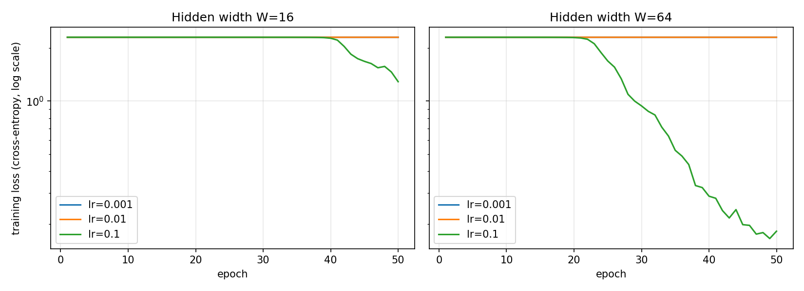

# Lab 2: A neural network from scratch

## 1. Goal
Build a two-hidden-layer neural network using only NumPy: forward pass, cross-entropy loss and hand-derived backpropagation. Validate the gradients with numerical gradient checking, train on the digits dataset with different learning rates and widths, and measure the cost of the forward and backward passes.

## 2. Method
- **Data:** `load_digits` (1797 samples, 8x8 images). Inputs divided by 16, labels one-hot encoded, 70/30 stratified split with `random_state=42` (1257 train / 540 test). Seeds (`random`, `numpy`, `torch`) set to 42.
- **Network (designed on paper):** 64 -> W -> ReLU -> W -> ReLU -> 10 -> softmax. Weight shapes (64, W), (W, W), (W, 10); bias shapes (W,), (W,), (10,). Weights ~ N(0, 0.01) (standard deviation 0.01), biases zero. Parameter count: 64W + W² + 10W + 2W + 10 = 1 482 for W=16 and 8 970 for W=64.
- **Forward pass:** layer by layer, `Z = A·W + b`, ReLU, final softmax (with max-subtraction for stability).
- **Loss:** mean cross-entropy over the batch.
- **Backward pass (chain rule):** for softmax with cross-entropy the gradient of the logits is `(P − Y)/B`; for each layer `dW = Aᵀ·dZ`, `db = sum(dZ)`, `dA = dZ·Wᵀ`, and `dZ = dA ⊙ 1[Z > 0]` through ReLU.
- **Gradient check:** 10 weights (3 from W1, 3 from W2, 4 from W3) nudged by ±1e-5, central difference compared to the analytic gradient, relative error `|a − n| / (|a| + |n|)`. Done in float64.
- **Training:** SGD, shuffle every epoch, mini-batch 32, 50 epochs, learning rates 0.001 / 0.01 / 0.1, widths 16 / 64 (6 runs). Training loss logged every epoch, test accuracy at the end.
- **Timing:** forward and backward timed separately, 10 warm-up runs, median of 100, for batch 32 and for the full train set (1257 samples).
- Code: `src/nn.py`, `src/data.py`, `src/lab2.py`. Raw results are in `results/`.

## 3. Results

**Sanity checks (`results/sanity_checks.csv`):** output shape is (32, 10); the largest deviation of a row sum from 1 is 3.3e-16 (limit 1e-6); the loss of the untrained network is 2.3026 = ln(10) for both widths.

**Gradient check (`results/gradient_check.csv`):** 

| Point | W=16 | W=64 |
|---|---|---|
| After 60 epochs of training | 10/10 pass (max rel. error 2.4e-7) | 10/10 pass |
| At the N(0, 0.01) initialisation | 8/10 pass | 9/10 pass |

**Training (`results/final_accuracy.csv`, `results/loss_curves.png`):**

| Width | lr | Final train loss | Final test accuracy |
|---|---|---|---|
| 16 | 0.001 | 2.3026 | 0.1019 |
| 16 | 0.01 | 2.3027 | 0.1019 |
| 16 | 0.1 | 1.2883 | 0.5037 |
| 64 | 0.001 | 2.3025 | 0.1019 |
| 64 | 0.01 | 2.3025 | 0.1019 |
| 64 | 0.1 | 0.1824 | 0.9056 |

**Extra experiment (not required, `results/extra_final_accuracy_he_init.csv`):** the same grid with He initialisation (std = sqrt(2/fan_in)) instead of N(0, 0.01):

| Width | lr 0.001 | lr 0.01 | lr 0.1 |
|---|---|---|---|
| 16 | 0.2222 | 0.8704 | 0.9500 |
| 64 | 0.7000 | 0.9444 | 0.9704 |

**Timing (`results/timing.csv`, median of 100 runs, microseconds):**

| Width | Batch | Forward | Backward | Backward / forward |
|---|---|---|---|---|
| 16 | 32 | 21.9 | 24.2 | 1.11 |
| 16 | 1257 | 561.4 | 661.7 | 1.18 |
| 64 | 32 | 47.3 | 64.8 | 1.37 |
| 64 | 1257 | 1078.3 | 1730.5 | 1.60 |

## 4. Explanation of the timing
Both passes are dominated by matrix multiplications. The forward pass of one layer needs one matmul (`A·W`). The backward pass needs two per layer (`Aᵀ·dZ` for the weight gradient and `dZ·Wᵀ` for the signal sent to the previous layer; only one for the first layer), so in theory it costs about twice the arithmetic of the forward pass. In my measurements the backward pass is only 1.1x to 1.6x slower. The reason is that for small matrices the time is not dominated by multiplication arithmetic but by fixed overheads (Python calls, memory allocation, element-wise operations such as ReLU, softmax and the gradient masks). As the matrices get bigger (W=64, large batch), the ratio grows (1.11 for W=16 with batch 32, 1.60 for W=64 with the full dataset) and moves towards the theoretical value of about 2, because the matmul share of the work grows: the cost of a matmul grows with batch × W², while the overheads grow much slower. So the backward pass dominates, and it does so because it performs more matrix multiplications.

## 5. Conclusions
1. My hand-derived backpropagation is correct. After training, the analytic and numerical gradients matched for 10 out of 10 checked weights for both widths (relative error below 1e-6). At the very start, with weights from N(0, 0.01), one or two weights in 10 failed the check, but only because the first two layers have gradients around 1e-6, and the rounding error of the numerical derivative is then as big as the value. So the check has a precision limit here; the code is not wrong, and this is why I also checked on a trained network. The chain rule is also why backpropagation needs the activations saved from the forward pass: `dW = Aᵀ·dZ` cannot be computed without `A`.
2. Initialisation and learning rate decided whether the network learned at all. With N(0, 0.01) weights every layer makes the signal smaller, so the loss stayed at ln(10) = 2.30 for 20 to 40 epochs. Only lr = 0.1 left this plateau within 50 epochs (W=64 reached 0.9056 test accuracy, W=16 only 0.5037), while lr = 0.001 and 0.01 stayed at about 10 percent, which is random guessing for 10 classes. My extra run with He initialisation reached up to 0.9704, so the network works, and the bad results come from the prescribed small initialisation together with only 50 epochs. In practice I would not use such a small initialisation.
3. Everything in the network is matrix multiplication, so cost grows with matrix size. The forward pass needs one matmul per layer, the backward pass needs two, so the backward pass should be about twice as expensive, and together with the forward pass a training step costs about three forward passes. I measured only 1.1x to 1.6x because small matrices are dominated by overheads, but the ratio grew with W and with batch size. The wider network (W=64) learned better, but it was about 2x to 3x slower per pass. This is the usual trade-off between accuracy and cost, and it is also why inference (only the forward pass, no stored gradients) is much cheaper than training.

## Notes and limitations
- Timings are machine-dependent. Accuracy for a single seed on 540 test samples has a noise of about ±1 percentage point.
- Runs with accuracy 0.1019 are chance level (the network predicts one class).
