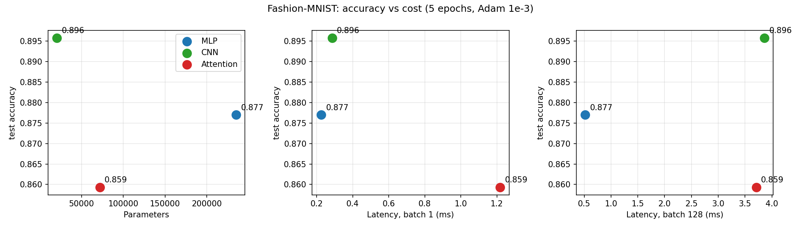

# Lab 3: Architectures and their costs

## 1. Goal
Compare three architectures on Fashion-MNIST (MLP, CNN, small attention model) by accuracy, parameter count, FLOPs (calculated by hand and measured with profiling tools) and inference latency, and decide which one is the most cost-effective.

## 2. Method
- **Data:** `torchvision.datasets.FashionMNIST`, `ToTensor()` + `Normalize((0.2860,), (0.3530,))`. Official train set (60k) split into 55k train / 5k validation (seed 42), official 10k test set, batch size 128. All seeds set to 42, the same seed is set before building and before training each model.
- **Models (as specified in the manual):**
  - MLP: Flatten 784 -> Linear 256 -> ReLU -> Linear 128 -> ReLU -> Linear 10.
  - CNN: Conv(1,16,3,pad 1) -> ReLU -> MaxPool2 -> Conv(16,32,3,pad 1) -> ReLU -> MaxPool2 -> Flatten -> Linear(32x7x7, 10).
  - Attention: the 28x28 image is cut into 16 patches of 7x7, Linear 49 -> 64, a learnable positional embedding (my addition, the manual does not mention it), 2 Transformer encoder layers (d_model 64, nhead 4, dim_feedforward 128), mean pooling, Linear 64 -> 10.
- **Parameters:** `torchinfo.summary`, cross-checked with `sum(p.numel())`.
- **FLOPs:** hand calculation with the chapter 4 formulas (1 multiply-add = 2 FLOPs; biases, activations, softmax and LayerNorm ignored), compared with `thop.profile` (thop reports MACs, so I multiplied by 2) and, as an extra tool, `torch.utils.flop_counter.FlopCounterMode`.
- **Latency:** CPU, `eval()` + `torch.no_grad()`, after warm-up; batch 1 = median of 100 runs, batch 128 = median of 20 runs.
- **Training:** 5 epochs, Adam, lr 1e-3, batch 128; accuracy on the validation set after every epoch, final accuracy on the test set.
- Code is in `src/` (`models.py`, `flops.py`, `lab3.py`), raw results in `results/`.

## 3. Results

### 3.1 Parameters
| Model | Parameters (torchinfo) | Target from the manual |
|---|---|---|
| MLP | 235 146 | 100k-150k |
| CNN | 20 490 | 100k-150k |
| Attention | 71 818 | 100k-150k |

The architectures given in the manual do not reach the target of 100k-150k parameters (MLP is above it, the other two are below). I implemented the layers exactly as listed and did not change them, so the three models are not equal in size. This is important when reading the comparison: the CNN is the smallest model.

### 3.2 FLOPs: hand vs measured (one forward pass of one image)
Hand calculation for one layer of each type:

| Layer | Formula | FLOPs |
|---|---|---|
| Linear 784 -> 256 | 2 x in x out | 401 408 |
| Conv2d 16 -> 32, 3x3, output 14x14 | 2 x K x K x C_in x C_out x H_out x W_out | 1 806 336 |
| Attention QKV projections (seq 16, d 64) | 2 x seq x d x 3d | 393 216 |
| Attention scores QK^T (seq 16, d 64) | 2 x seq^2 x d | 32 768 |
| Full encoder layer (QKV + scores + context + output projection + feed-forward) | | 1 114 112 |

Whole models:

| Model | Hand | thop (default) | thop (fast path off) | torch FlopCounter |
|---|---|---|---|---|
| MLP | 469 504 | 469 504 | 469 504 | 469 504 |
| CNN | 2 063 488 | 2 063 488 | 2 063 488 | 2 063 488 |
| Attention | 2 329 856 | 101 632 | 1 182 976 | 2 198 784 |

For the MLP and the CNN the hand calculation and both tools agree exactly. For the attention model they differ, and the difference has clear reasons:
- thop with default settings gives 101 632 FLOPs: only the patch projection and the final linear layer. In `eval()` mode with `no_grad`, PyTorch runs the Transformer layer through one fused "fast path" kernel, so thop's hooks on the sub-layers never run.
- With the fast path switched off thop gives 1 182 976. This is the patch projection (100 352) + the two feed-forward blocks (1 048 576) + the head (1 280) + LayerNorm (32 768, which my hand count ignores). It still misses everything inside `nn.MultiheadAttention`, because thop has no rule for this module: Q, K, V projections (786 432), scores and context (131 072) and output projection (262 144), 1 179 648 FLOPs in total.
- `FlopCounterMode` gives 2 198 784. It counts all matrix-multiplication layers, but it does not count the attention scores and context (131 072 FLOPs), because on CPU they run inside the fused `scaled_dot_product_attention` operator that this counter does not know. 2 329 856 - 2 198 784 = 131 072, exactly this part.

So the hand-calculated value is the most complete one, and the tools undercount attention because the matrix products inside it are hidden from them.

### 3.3 Latency and accuracy (CPU, my own PC; see the note at the end)
| Model | Test accuracy | Latency batch 1 | Latency batch 128 | Per sample at batch 128 |
|---|---|---|---|---|
| MLP | 0.8770 | 0.225 ms | 0.52 ms | 4.1 us |
| CNN | 0.8958 | 0.286 ms | 3.86 ms | 30.2 us |
| Attention | 0.8593 | 1.218 ms | 3.71 ms | 29.0 us |

## 4. Which architecture is the most cost-effective
- **Against parameters,** the CNN is clearly the best: the highest accuracy (0.8958) with the fewest parameters (20k), 11 times fewer than the MLP (235k) that is less accurate. The reason is weight sharing: the same small 3x3 filters are reused at every position of the image, so few weights are needed and each weight is used many times. The MLP uses every weight only once per image (dense matrix multiplication, no data reuse), and each of its 784 inputs needs its own weights in the first layer, so parameters are spent on pixel positions instead of on patterns.
- **Against latency,** the picture is different. At batch 1 the MLP is the fastest (0.22 ms): its work is a few small matrix-vector products, 470k FLOPs. The CNN needs 4.4 times more FLOPs (2.06M) because the same filters are applied at all positions, so cheap in parameters does not mean cheap in computation; it has the highest FLOP count per parameter in this lab (about 100 FLOPs per parameter, against 2 for the MLP). Its batch-1 latency is still close to the MLP (0.29 ms, 1.3x). The attention model has the highest FLOPs and the highest batch-1 latency (1.22 ms, 5.4x the MLP), partly because of many small operations (LayerNorm, softmax, reshaping, 2 layers), which are memory-bound and not matrix multiplication. Its cost also grows with seq^2: the 16x16 attention score matrix is computed fresh for every input and must be stored and moved, unlike convolution weights.
- **At batch 128** latency is dominated by compute and by how well each operation uses the hardware. The MLP is far ahead (4.1 us per sample), because dense matrix multiplication is the operation that CPUs and libraries are best optimised for. The CNN (30.2 us) and the attention model (29.0 us) are about equal and 7 times slower per sample than the MLP, although they need only 4.4x and 5x more FLOPs. So both execute fewer FLOPs per second than the plain matrix multiplications of the MLP (convolution has more overhead from data layout and pooling, attention from softmax, LayerNorm and reshaping). The measurement depends on the hardware and the library (on a GPU the order could be different), so I do not generalise it.
- **Conclusion on cost-effectiveness:** if accuracy per parameter or memory matters (edge, mobile), the CNN is the best choice. If the lowest latency matters at small cost, the MLP wins, with 1.9 points of accuracy lost. The attention model is not cost-effective on this small 28x28 task with 5 epochs: it is the least accurate and not the cheapest in any measure, because attention pays for flexibility (every patch can look at every other) which this small image does not need, and it usually needs more data and more epochs.

## 5. Conclusions
1. Parameter count, FLOPs and latency are three different costs and they do not rank the models in the same order: the CNN has the fewest parameters but 4.4x more FLOPs than the MLP, and the MLP has the most parameters but the lowest latency. A single number is not enough to choose an architecture.
2. The access pattern explains most of the differences: weight reuse in the CNN gives accuracy per parameter, dense matrix multiplication in the MLP gives hardware efficiency, and the seq^2 attention matrix plus many small memory-bound operations makes the attention model the most expensive per unit of accuracy here.
3. Profiling tools must be checked against a hand calculation: thop and the PyTorch FLOP counter agreed with my numbers for MLP and CNN, but undercounted the attention model by a factor of 1.06 to 23 depending on the tool and settings, because the fused attention operators are invisible to them.

## Notes and limitations
- The manual's target of 100k-150k parameters is not met by the listed architectures (section 3.1); I kept the listed layers.
- Latency depends on the machine (CPU model, number of threads, library); these numbers were measured on my own Windows PC (CPU only) with PyTorch 2.3.1, and each model was trained once (one seed), so differences of about 1 point of test accuracy can be noise.
- A learnable positional embedding (1 024 parameters) was added to the attention model.
